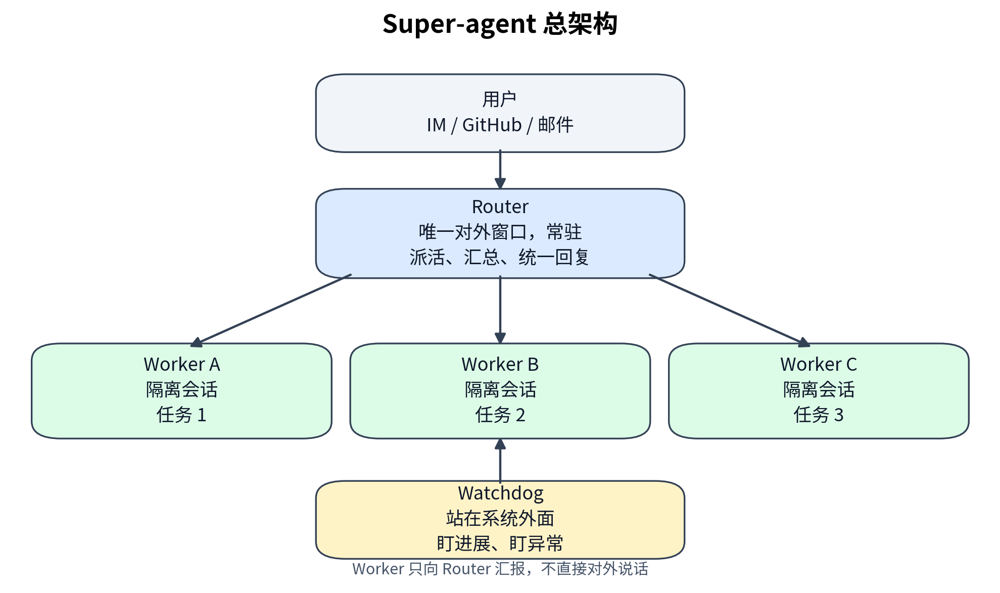
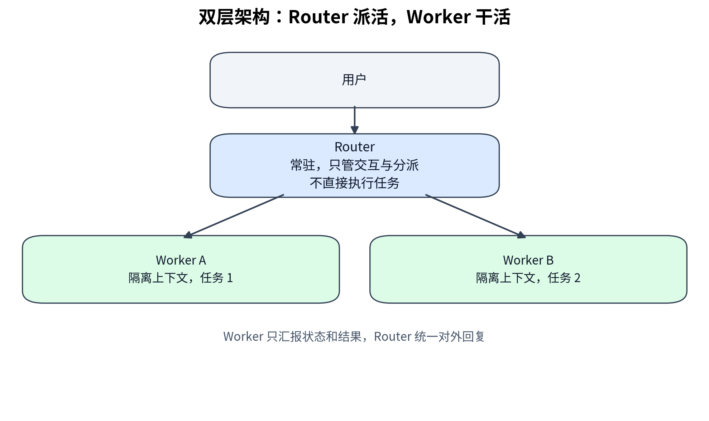
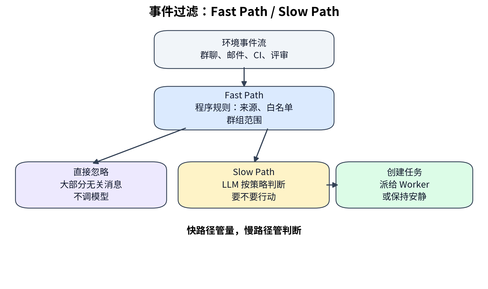
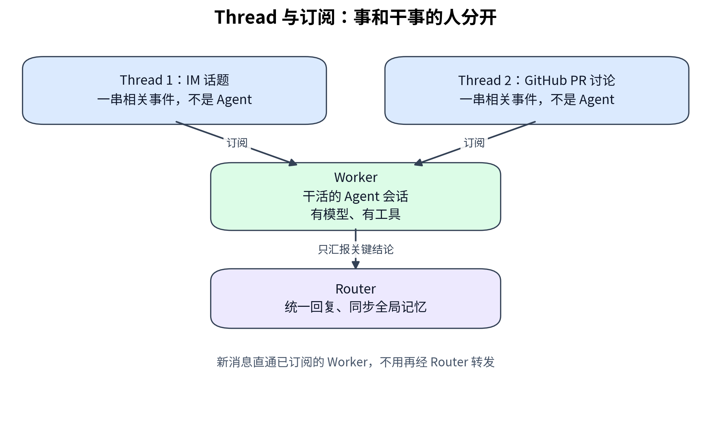
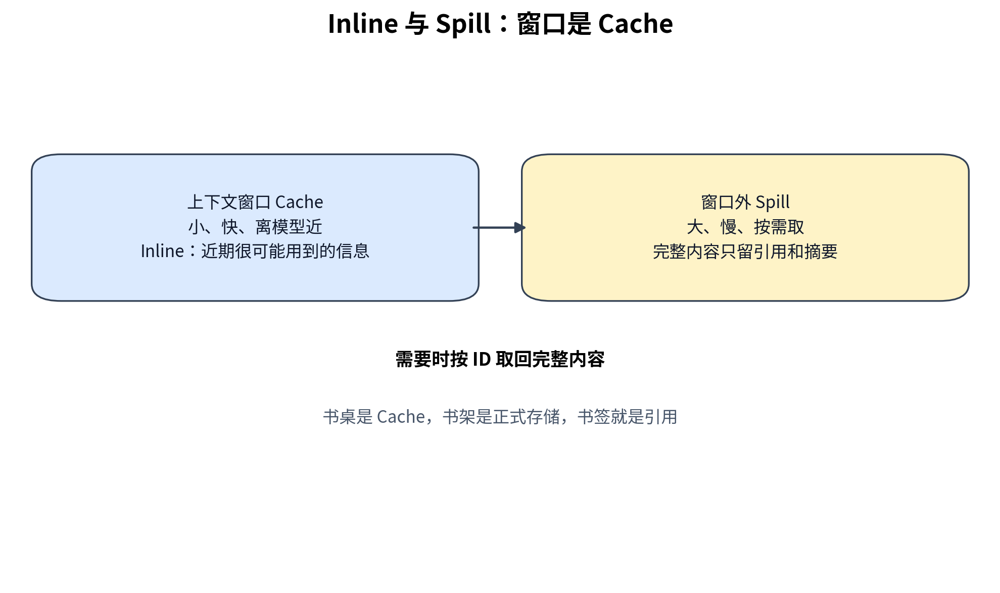
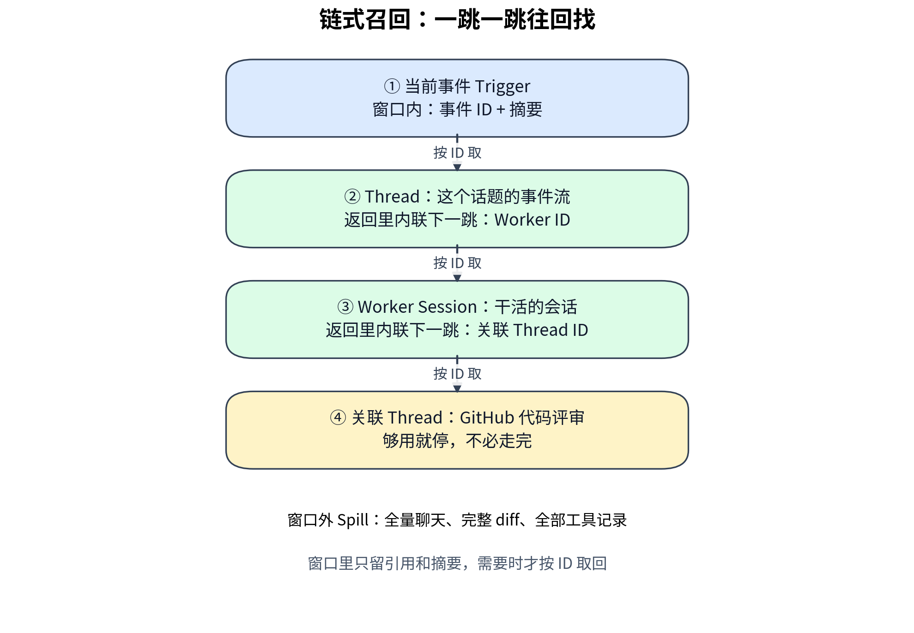
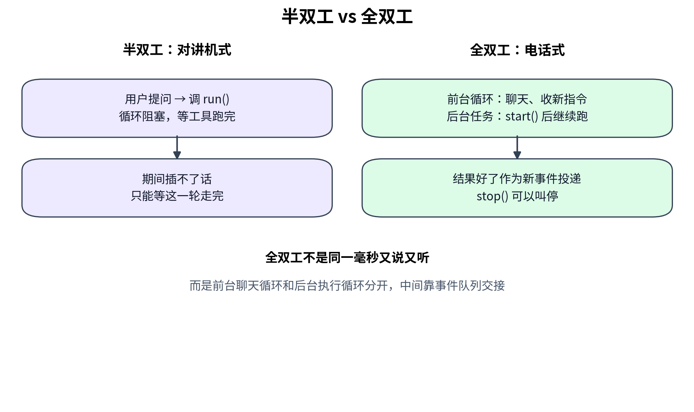
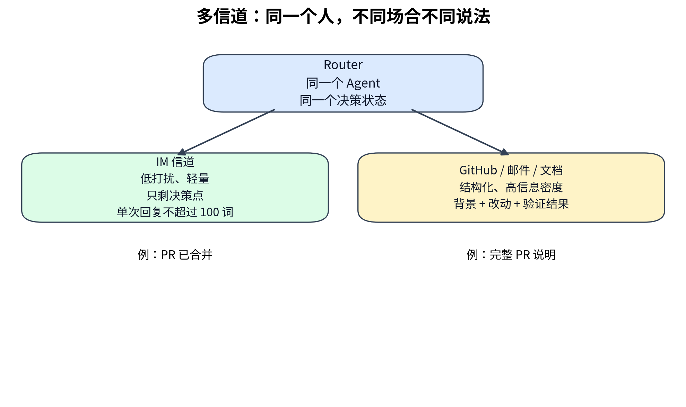
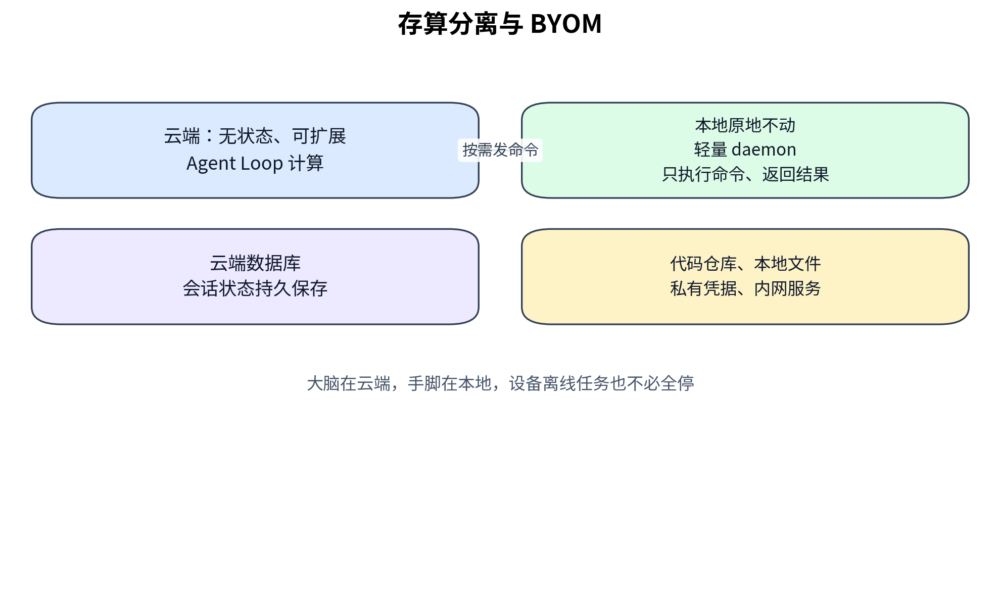
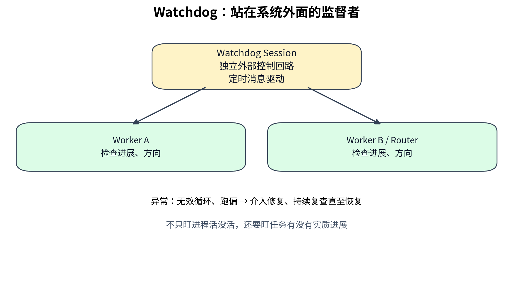

# DeepSeek Super-agent 解析

> 个人学习笔记，不是 DeepSeek 官方文档。
> 解析对象：DeepSeek Harness 团队 2026 年 10 月 31 日发表的
> 《Super-agent 设计探索：迈向更自主的 Agent 系统》。
> 该文是一篇面向工程实践的架构探索，原型 `dsh-superagent-prototype`
> 只是验证技术路线的 MIT 研究原型，不是 DeepSeek 的正式产品，也不是一个新模型。

- 原文全文转载：http://www.uml.org.cn/ai/202611023.asp?artid=27640
- 开源原型：https://github.com/deepseek-ai/dsh-superagent-prototype
- 详细解读参考：https://blog.ccino.org/p/deepseek-super-agent-opensource-2026/

## 一句话结论

Super-agent 要解决的瓶颈不在模型够不够聪明，而在人的注意力：
一个人通常只能同时跟进 3 到 5 个活跃 Session。
它的办法是把会话管理、上下文同步和多任务调度从人手里移到系统层面，
人上移到定目标和验收，AI 在底层做派活和执行。

## 四个基础特征

- **连续**：同一个任务可以在 IM 群聊和 GitHub Pull Request 评审之间接着推进，
  用户感觉始终只面对一个 Agent。
- **高效**：可以并行处理多个复杂任务，不必等上一个命令完成才接下一条指令。
- **主动**：持续观察环境事件，值得处理的事情可以自己推进，不需要时保持安静。
- **持久**：始终在线，长期运行中遇到异常可以自动恢复。

## 五个支撑模块

1. 双层架构：Router / Worker
2. 事件驱动
3. 面向人的交互
4. 计算、状态与环境的分离
5. 外部 Watchdog

## 双层架构：Router 派活，Worker 干活

- **Router 层**：常驻的全局路由层，承接所有入口的人类交互，
  汇总跨任务的信息与决策，充当全局的序点、协调点和记忆。
  它在设计上不直接执行具体任务，只负责交互与分派，甚至可以不配备 Bash 工具。
- **Worker 层**：负责具体执行的会话，彼此上下文隔离，挂载完整的执行工具，
  在独立上下文中专注完成单一任务。
  Worker 不直接与人类交互，它的推理过程和工具调用不直接输出到外部信道，
  而是向 Router 汇报状态，由 Router 统一向用户回复。

表面上看，这和常见的主 Agent 加子 Agent（Agent Team）很像，但侧重点不同：
Agent Team 常常是把单个复杂任务内部拆步骤、拆角色，Team Lead 需要深入细节、
高频协调，推理负担很重。
Super-agent 的 Router 只处理任务之间的高层关联与分派，不介入单任务内部的拆解；
Worker 内部在执行复杂单任务时，还可以再创建 Subagent，也可以本身就是一个
Agent Team，这些对上层的 Router 保持透明。

### Router 的全局记忆从哪来？

Router 也是一个 Session，但它的“全局”不是把所有东西都装进自己的上下文窗口，
而是知道全局状态、知道东西在哪、需要时能找回来：

1. **常驻汇总**：所有跨任务的信息与决策都在 Router 汇总。
2. **只记结论和状态**：Worker 只汇报关键结论和状态，不把全过程倒给 Router，
   所以 Router 的上下文不会被工具输出、代码 diff、测试日志撑爆。
3. **摘要加引用**：窗口里放 ID 和摘要，完整内容留在窗口外，按需取回。
4. **外部持久化**：推进 Agent Loop 的计算可以做成无状态的，
   会话状态存入数据库，连续性由持久化存储保障，而不是只靠一次对话的窗口。

Router 在实现上也不必局限于单个 Session，甚至部分逻辑未必需要调用 LLM，
原文只是选择了最直接的单个常驻 LLM Session 作为核心实现。
当规模扩大、运行周期拉长到跨月时，长程记忆仍然是制约可扩展性的主要瓶颈，
Router 要不要水平切分、切多细，都是还没定论的权衡。

## 事件驱动：让 Agent 自己听见世界

驱动 Agent 的主要输入不再是人类在 Session 里逐条键入的提示词，
而是环境中的半结构化事件，统称为 **Trigger**：
群聊消息、邮件与日程提醒、代码审查评论、CI 运行结果都算 Trigger。

### 两级过滤：Fast Path / Slow Path

- **Fast Path（快路径）**：用确定性代码处理，速度快、成本低，
  只处理规则明确、高频的情况。程序层按事件来源、群组范围、白名单等条件
  快速准入检查，在调用模型之前滤掉大部分无关消息。
- **Slow Path（慢路径）**：用大模型推理处理，灵活、能理解语义，
  但速度慢、成本高。通过程序层准入的候选事件交给 LLM，
  由它按提示词里的策略和上下文判断是否需要行动。

一句话：快路径管量，慢路径管判断。
只有快路径会漏掉需要语义理解的活，只有慢路径会被海量噪音拖垮。

### Thread 与订阅

同一个 GitHub Pull Request、同一个 IM 话题或同一封往来邮件串下的连续事件，
构成一条事件流，即 **Thread**。

- Thread 不是 Agent，它不会思考、不会调工具，它就是一串相关的事件，
  像一个帖子、一个工单、一个群话题。
- Worker 才是干活的 Agent 会话。
- Router 看到某个 Thread 的初始事件，判断这是个新任务，于是创建一个 Worker；
  这个 Worker 直接订阅对应的 Thread，之后这个 Thread 的新消息就由程序直通给它，
  不用再经 Router 转发，这就是订阅直通的快路径。
- 如果新事件超出了当前任务的范围，Worker 可以取消订阅，或交回 Router 重新分派。
- 订阅是多对多的：一个 Worker 可以同时订阅多个相关的 Thread，
  同一个 Thread 也可以被多个 Worker 订阅，新事件会同时直通给所有订阅它的 Worker。

一个任务跨 IM 和 GitHub 时，底层其实是两条 Thread，
IM 话题是一条，GitHub PR 讨论是另一条。
但同一个 Worker 可以同时订阅这两条，Router 在全局层面又知道它们属于同一个任务，
所以用户感觉上是一个任务连续推进。

## 上下文组织：Inline & Spill 与链式召回

有限的上下文窗口可以当作 Cache 来管理：

- **Inline**：把近期很可能用到的信息直接内联进当前上下文窗口，
  省去额外的工具调用往返。
- **Spill**：把超出窗口预算或低频使用的完整信息留在窗口之外，
  只在窗口内保留引用或摘要，模型需要完整内容时再调用工具读取。
- **Cache**：一小块速度快、离得近的临时存储，存很可能马上又要用的东西，
  省得每次都去慢的地方重新拿。书桌和书架就是最直观的类比：
  正在看的书放桌上，用完的放回书架，只在桌上留个书签记着它在哪。

把 Inline & Spill 一致地应用到系统中的各类对象后，
就得到了一种按需展开的多跳检索机制，即**链式召回（Chain of Recall）**：

系统给 Trigger、Thread、Worker Session 等对象赋唯一 ID，
并在注入时内联紧密关联对象的 ID，使这些对象在底层构成一张引用图，
模型可以从当前事件出发，顺着引用关系逐步按需召回上下文。

它的本质更像顺着超链接点过去，或者顺着数据库外键一表一表查过去，
而不是平时说的向量检索：

- 向量检索靠语义相似度“猜”哪些内容相关，哪怕之前没建立过关联也能找回来。
- 链式召回靠事先记好的引用关系“找”过去，精确、可解释、不用建 embedding 索引，
  但前提是关联得记对、记全。一旦某个对象没记关联 ID，或者中间一环断了，
  链就断了，模型再聪明也顺不下去。
- 链要跳几跳、什么时候停，还是模型自己在判断“够不够了”。
  跳少了可能信息不全，跳多了每次都是一次工具调用，延迟和 token 也会涨回来。

## 面向人的交互：异步 ReAct Loop 与多信道

### 半双工 vs 全双工

大学通信里的原版概念：

- **单工**：只能单向，比如广播。
- **半双工**：双向都可以，但同一时刻只能一个方向，像对讲机，
  说完得说一声 over，对方才能说，不能同时抢话。
- **全双工**：双向同时，像打电话，两边可以同时说、同时听。

经典 ReAct 是半双工：模型发起一次同步的 `run()` 工具调用后，
循环会阻塞，直到工具执行完毕并返回最终结果，
在此期间会话无法响应任何新的用户输入。
工具要是跑个全量测试要十分钟，这十分钟里对话就是冻住的。

异步 ReAct Loop 是全双工：把耗时的命令和子任务工具调用改成异步的
`start()` 和 `stop()`。模型调用 `start()` 后立即收到“已启动”的返回，
循环不再等待该工具；后台工具执行完成后，系统再将最终结果作为一条新的事件
投递进会话；同时模型也可以调用 `stop()` 主动终止执行时间过长的后台命令。
前台对话响应与后台任务执行因此解耦，Agent 在后台运行耗时任务的同时
也能响应人类输入，新输入在当前推理步结束后即被处理，不必等待后台工具完成。

严格说，这里的全双工不是模型真的在同一毫秒又说又听，
而是前台聊天循环和后台执行循环分开了，中间靠事件队列交接，
效果上就像从对讲机换成了电话。
这一异步任务机制已经在 DeepSeek Harness 中实现，但尚未默认开启。

### 多信道交互：同一个人，不同场合不同说法

不同工作信道的信息密度与交互习惯不同，系统的输出需要与之匹配。
如果把面向单人终端的交互方式直接搬入群聊，
把冗长的推理过程与密集的工具调用原样输出，在多人协作中极易造成信息过载。

- **IM 等即时通讯信道**：侧重低打扰的轻量沟通，
  像人类同事一样只在需要决策或验收时发送通知，只问直接问题、给简短结论。
  原文验证过的一条简单有效的硬性规定是单次回复不超过 100 词。
- **GitHub、邮件与文档等异步信道**：侧重结构化、高信息密度的异步交付，
  例如在创建或更新 Pull Request 时按项目规范撰写完整的问题背景、
  改动说明与验证结果，或在个人助手场景下直接起草结构化的邮件与文档摘要。

这里的要点不是排版，而是注意力算账：
IM 是同步感强、多人在线、打扰成本高的场合，多说一句就是在场所有人的
注意力在付账，所以要短到只剩决策点；
GitHub 和邮件是异步、可留存、可检索的场合，读者有时间细读，
这时候只给一句话结论，评审人没法验证，只能回来反复追问，
注意力成本会以另一种形式回来。

跨信道连续，也不等于跨信道同一种说法。
同一个任务、同一个 Agent、同一个决策状态，
在 IM 里可以是一句“PR 已合并”，在 GitHub 里是一份完整的背景加改动加验证。
就像同一个人，开会时说话和写报告时语气肯定不一样，
但你还是能感觉到是同一个人。

## 计算、状态与环境的分离：BYOM

现有的本地 Agent 默认把推进 Agent Loop 的计算、
需要持久保存的会话状态，以及代码仓库与本地工具链等执行环境绑定在同一台设备上。
一旦设备休眠或离线，Agent 就会停止运行。

Super-agent 分两步解耦：

1. **计算与状态分离**：推进 Agent Loop 的计算放入云端无状态的弹性计算容器，
   Session 等持久化状态存入数据库。计算容器可以水平扩展、重启或替换，
   会话与任务的连续性由持久化存储保障，从而摆脱单台本地设备的生命周期限制。
2. **计算与执行环境分离**：Agent Loop 在云端运行，
   而重状态的执行环境留在原地，仅在端侧部署一个不保存会话状态的轻量 daemon，
   它只负责执行命令与返回结果。
   这一思路既支持 BYOM（Bring Your Own Machine），
   即把用户日常使用的开发机或个人电脑接入云端 Agent，
   也支持接入云端托管机器或按需创建的计算环境。

## Watchdog：站在系统外面的监督者

持久在线的分布式系统很难仅靠主系统内部逻辑保证长期可靠运行，
需要在主系统之外引入独立的外部控制回路。
Super-agent 在主系统外部配置了一个独立的 Watchdog Session，
用定时消息驱动它，构成外部的 Control Loop。
Watchdog 除了处理接口报错、状态恢复失败等基础设施故障，
还会由模型判断各个 Worker 是否有实质进展、方向是否偏离整体目标，
发现异常时及时介入修复，遇到外部偶发故障则持续复查直至恢复正常。

借鉴计算机系统中的投机执行思想，Agent 可以在还不确定结果是否会被采用时，
根据环境信号在后台提前尝试，通过消耗额外的后台算力来减少人类的等待与介入成本。
结果有价值就交付，没有价值就丢弃。

研发协作场景的例子是“静默复现并修复”策略：
当群里有人反馈问题或讨论改动方案时，Agent 先在后台尝试复现并寻找修复方案，
只有在确认问题并找到简单的修复方案后，才会把结果交付给用户，
否则全程保持安静。
个人助手场景的例子是收到会议邀约时，先在后台核对日程冲突、
搜集相关背景资料并备好回复草稿，待用户过目后即可直接确认发出。

这个策略有明确的赌注属性：赌对了，人类等待时间大幅缩短；
赌错了，烧掉的是算力和 token。
原文没有给出投机执行的误判率数据，这是全文最需要补的一块实验。

## 实验数据：调度确实快，但要打折看

初步实验用群聊和 GitHub CI 消息流同时驱动四种方案：
单次实验包含约 300 条消息，其中约 20 条是工作请求，其余是闲聊、跟进、
叫停和 CI 消息。编码工作用一个只消耗时间的工具代替，
因此实验衡量的是系统的调度与协作能力，而非对单个任务的执行能力。
每种方案重复运行 5 次。

| 方案 | 任务完成时间 P50 / P95（分钟） | 单次实验读缓存 Token |
| --- | --- | --- |
| Super-agent | 12.4 / 15.7 | 2323 万 |
| Super-agent，去掉直通 | 12.6 / 15.5 | 3177 万 |
| 单 Session + Subagent 工具，中性提示 | 20.4 / 29.5 | 605 万 |
| 单 Session + Subagent 工具，提示优先委派 | 13.8 / 29.0 | 1082 万 |

- Super-agent 的 p50 与 p95 显著优于带 Subagent 工具的单 Session。
  原因之一是中性提示下，模型在 5 次运行中一次都没有调用 Subagent，
  所有工作都在主 Session 中进行并不断被新消息打断。
- 去掉直通后，任务完成时间与完整版基本一致，
  但 Router 需要做出的决定增加了约 30%，总读缓存 token 从 2323 万增加到 3177 万，
  增幅约 37%。直通机制不提高任务完成质量与速度，
  但为 Router Session 节省了可观的 token 与推理开销。
- Router 层批处理压测：需要决定的 Trigger 到达速率从每分钟约 1 条升至约 40 条时，
  平均 batch 大小从 1.0 升至 2.8，而单次请求耗时仅从 2.5 秒增至 3.9 秒，
  单个决定分摊的推理时间从 6.4 秒降至 1.6 秒。
  当外部事件突发拥堵时，Router 层能够通过自动合并积压事件提高有效吞吐。

官方自己划的线一定要记住：这些实验基于合成负载与简化环境，
主要评估系统调度与协作能力，并不衡量单个任务的实际执行能力。
数字证明的是“这套组织结构跑得动”，至于“活干得好不好”，另说。

比实验数据更有分量的细节是：基于这套思路和 DeepSeek Harness 构建的
内部 Super-agent 实例，已经在持续运行，参与问题复现与修复、
代码审查响应，以及 DeepSeek Harness 自身的迭代。

## 冷思考：未解难题与安全边界

原文列的待解决问题包括：Router 层怎么随任务规模扩展、
跨月甚至跨年的长程记忆、脱离 Session 后的人机协作方式、
不同 Agent 实例之间的 A2A（Agent-to-Agent）通信，以及安全与隐私。

安全那一条值得单独展开。云端 Agent 接入本地设备后，
提示词注入、端侧凭据泄露、跨设备权限风险都需要进一步解决。
BYOM 把它们捏到了同一个攻击面上：云端大脑可以指挥你本地的手脚，
那么一次成功的提示词注入，攻击路径就能从一条聊天消息直达你的文件系统、
你的 API 密钥、你的 git 凭据。

常驻自主形态让“模型输出永远不该被当成可信指令”这条原则变得更难执行：
一个主动监听群消息、自动订阅 Thread、投机执行的系统，
接收不可信输入的面比手动对话大了几个量级。
这在架构上无解，只能在权限粒度和确认机制上一点点磨。
启动新活和续聊的权限尤其要分开：谁能让它开始干活，
和谁能在它已经开始的 PR 里继续说话，是两回事。

## 对个人 Agent 的借鉴：不必照搬，但思路可借

对单用户、十几个工具这个规模，直接照搬 Super-agent 就过重了。
真正可借鉴的是这几条：

- **Router 派活、Worker 隔离**：派活的只管分派和汇总，干活的互相隔离，
  一个任务崩了不污染其他任务和全局上下文。
- **确认不能省**：写操作先给草稿、确认后才写，确认 pending 的时候还能聊别的，
  回复要按任务路由回去，不能让新消息冲进同一个 pending 的确认。
- **Watchdog 盯进度**：不只盯进程活没活，还要盯任务有没有实质进展、
  是不是在无效循环里打转。
- **测调度与测质量分开**：调度快不等于活干得好，
  完成时间、Router 决策次数、缓存 token 这些是调度指标，
  任务正确率、代码质量、用户验收率是质量指标，两套账要分开算。

## 术语表

- **IM**：Instant Messaging，即时通讯。微信群、飞书群、Slack 群都算 IM，
  在本文里它是一个信道类型，不是某个具体产品的名字。
- **Bash 工具**：让 Agent 能在终端里执行 shell 命令的工具。
  模型本身只会输出文字，给了 Bash 工具后，它才能把命令发给系统去执行，
  再把执行结果拿回来继续思考，比如 `ls`、`grep`、`npm test`、`git diff`。
- **并发吞吐量**：在多任务同时跑的情况下，系统单位时间内能完成多少任务。
  并发是同一时间能同时推进多少个任务，吞吐量是单位时间内能完成多少个任务，
  延迟则是单个任务从开始到结束要多久，三者不是一回事。
- **Thread**：一条事件流。同一个 GitHub PR、同一个 IM 话题、
  同一封往来邮件串下的连续事件构成一个 Thread。
- **Worker**：真正干活的 Agent 会话，有模型、有工具、有自己隔离的上下文。
- **Fast Path / Slow Path**：快路径用确定性代码处理高频、规则明确的情况，
  慢路径用大模型推理处理需要语义理解的情况。快路径管量，慢路径管判断。
- **半双工 / 全双工**：半双工像对讲机，双向都可以但同一时刻只能一个方向；
  全双工像打电话，双向同时。Agent 里的全双工是前台聊天循环和后台执行循环解耦，
  中间靠事件队列交接。
